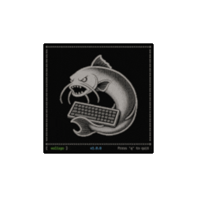

### Hey!

👾 I'm **Wallago**.

🦀 An open-source developer with a deep passion for Rust, Nix and terminals.

 
 
 
 

#### ⚡ Stats

I joined GitHub **7** years ago and have since pushed **4219** commits, opened **62** issues, submitted **226** pull requests, and earned **127** stars across **38** personal projects, with contributions to **20** public repositories.

I'm currently on a **10**-day commit streak.

#### 🌀 Projects

> **Building**: active work · **Maintaining**: used and kept up to date · **Stable**: done, fixes only · **Paused**: on hold · **Inactive**: no longer worked on

### Nix

| Project                                                                                 | Description                                             | State           |
| --------------------------------------------------------------------------------------- | ------------------------------------------------------- | --------------- |
| [nix-system-services-hardened](https://github.com/wallago/nix-system-services-hardened) | System services hardened (lynis BOOT-5264) under NixOS  | **Stable**      |
| [nix-config](https://github.com/wallago/nix-config)                                     | Personal NixOS / home-manager configuration             | **Maintaining** |
| [kestrel](https://github.com/wallago/kestrel)                                           | Monitoring TUI app for various info                     | **Building**    |

### Rust

| Project                                                   | Description                                                                                  | State           |
| --------------------------------------------------------- | -------------------------------------------------------------------------------------------- | --------------- |
| [skimmer](https://github.com/wallago/skimmer)             | AI agent that reads your RSS feeds and keeps only what's worth your time                     | **Building**    |
| [mind](https://github.com/wallago/mind)                   | MCP server exposing a Syncthing-shared notes folder                                          | **Building**    |
| [praline](https://github.com/wallago/praline)             | TUI app that scaffolds a well-made Rust repo: formatters, linters, tests, security and CI/CD | **Building**    |
| [bp-to-bagels-csv](https://github.com/wallago/bp-to-bagels-csv) | Import a Banque Populaire CSV export into a Bagels SQLite database                     | **Maintaining** |
| [ssh-to-age-rs](https://github.com/wallago/ssh-to-age-rs) | Convert SSH Ed25519 keys to age keys, for use with `sops-nix` and `sops`                     | **Stable**      |
| [flamingo](https://github.com/wallago/flamingo)           | TUI app to trim Nix configurations and reuse them elsewhere                                  | **Paused**      |
| [nix-bootstrap](https://github.com/wallago/nix-bootstrap) | TUI app to apply Nix configurations and save configuration profiles                          | **Paused**      |
| [rssh](https://github.com/wallago/rssh)                   | Android RSS client for a Miniflux server                                                     | **Paused**      |
| [project-banner](https://github.com/wallago/project-banner) | CLI tool to generate stylized project banners                                              | **Paused**      |
| [key-generator-secp256k1](https://github.com/wallago/key-generator-secp256k1) | Lightweight tool to generate 256-bit private keys with a CSPRNG and the secp256k1 curve | **Inactive** |
| [bitcoin-regtest-api](https://github.com/wallago/bitcoin-regtest-api) | Library to use Bitcoin regtest                                                       | **Inactive**    |
| [log-manager](https://github.com/wallago/log-manager)     | Rust library for managing and processing logs                                                | **Inactive**    |

### Hardware & firmware

| Project                                                           | Description                                                                          | State           |
| ----------------------------------------------------------------- | ------------------------------------------------------------------------------------ | --------------- |
| [kagu](https://github.com/wallago/kagu)                           | ZMK firmware for a handwired wireless split keyboard on Seeed XIAO nRF52840          | **Building**    |
| [canary](https://github.com/wallago/canary)                       | Rust firmware turning an ESP32-S3 touch LCD into an always-on desk widget            | **Building**    |
| [spider](https://github.com/wallago/spider)                       | Multi-screen info panel over ESP32                                                   | **Building**    |
| [zmk-config](https://github.com/wallago/zmk-config)               | ZMK firmware config for a 34-key split chocofi keyboard, Colemak-DH layout           | **Stable**      |
| [tsw101-rack-tray](https://github.com/wallago/tsw101-rack-tray)   | OpenSCAD 1U mount for the Teltonika TSW101 in 10-inch racks                          | **Stable**      |
| [nuc14-pro-rack-tray](https://github.com/wallago/nuc14-pro-rack-tray) | OpenSCAD 1.5U mount for the Intel NUC 14 Pro in 10-inch racks                    | **Stable**      |
| [chocofi-PCB](https://github.com/wallago/chocofi-PCB)             | KiCad PCB design for the chocofi, a 34-key wireless split keyboard                   | **Paused**      |
| [chocofi-casing](https://github.com/wallago/chocofi-casing)       | FreeCAD case design for the chocofi, a 34-key wireless split keyboard                | **Paused**      |

### Web

| Project                                       | Description                                                                 | State           |
| --------------------------------------------- | --------------------------------------------------------------------------- | --------------- |
| [labs](https://github.com/wallago/labs)       | Storefront for handmade hardware projects, sold in small limited-stock batches | **Building** |
| [bivouak](https://github.com/wallago/bivouak) | Every mountain refuge and hut, together on one map                          | **Building**    |
| [wallago](https://github.com/wallago/wallago) | My GitHub profile                                                           | **Maintaining** |

> 💡 Tip: Run `ssh git.wallago.dev` to browse my repositories in your terminal.

---

💖 [sponsor me](https://github.com/sponsors/wallago) to support my work!

**~** wallago

